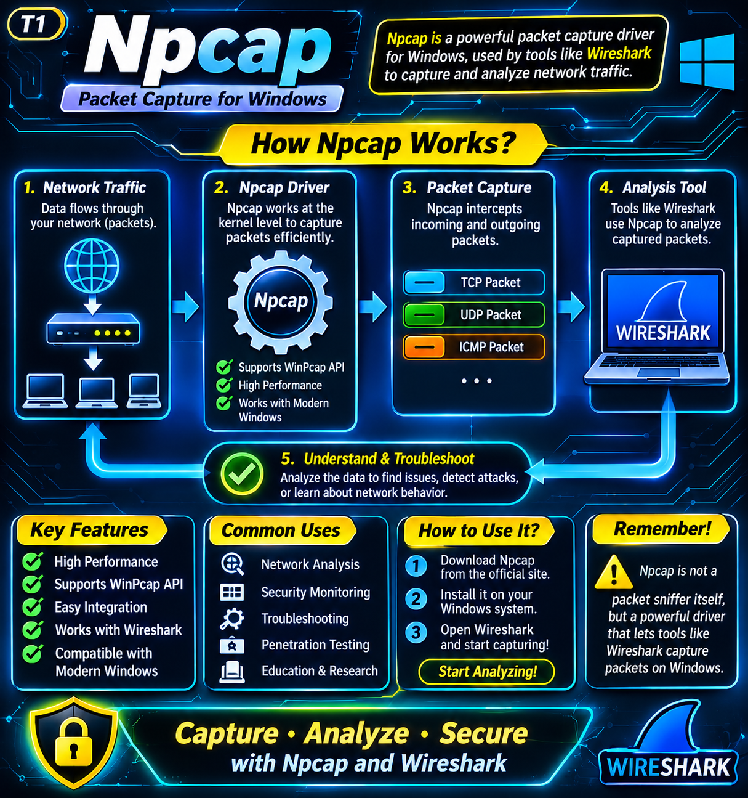

# Npcap — Complete Learning Roadmap

## Introduction

Welcome to my Npcap learning repository!

This repository contains my learning notes about **Npcap**, a Windows packet-capture technology used by network tools such as Wireshark, Nmap, and Python-based network analysis tools.

The purpose of this repository is to understand what Npcap is, why it is used, how it works, what information it can capture, and how it can help in network monitoring and cybersecurity projects.

I am also exploring Npcap as one component of my **Cyber Safety Box** project.

---

## 1. What Is Npcap?

Npcap is a packet-capture library and network driver for Windows.

In simple words:

**Npcap allows compatible software to capture network packets travelling through a selected network interface.**

A packet is a small unit of data that travels across a network.

For example, when you:
- Open a website.
- Send a message.
- Download a file.
- Connect to an online service.

Your device exchanges network data through packets.

Npcap gives compatible applications access to these packets so they can analyze network communication.

### Important Terms

| Term | Meaning |
|---|---|
| Packet | A unit of data transmitted over a network |
| Network interface | A connection point such as Wi-Fi or Ethernet |
| Driver | Software that helps Windows communicate with hardware or system components |
| Packet capture | Collecting network packets for analysis |
| Traffic analysis | Studying network communication |
| Library | Reusable software functions that other programs can use |

---

## 2. Why Do We Use Npcap?

Npcap helps applications access network packets that ordinary high-level networking interfaces may not expose.

It is commonly used for:

1. **Network Analysis:** Understanding how devices communicate.
2. **Troubleshooting:** Investigating network communication problems.
3. **Security Monitoring:** Studying suspicious or unexpected network traffic.
4. **Packet Inspection:** Examining packet headers and available packet data.
5. **Network Tools:** Providing packet-capture functionality to applications such as Wireshark and Nmap.
6. **Cybersecurity Learning:** Understanding network protocols and communication.

Npcap does not independently provide a complete network-monitoring dashboard. Other applications use its capture capabilities to perform analysis.

---

## 3. How Does Npcap Work?

Npcap works with the Windows networking system and the network adapter.

The basic process is:

1. **Network Communication:** Devices exchange data over a network.
2. **Network Interface:** Packets pass through a network interface, such as Wi-Fi or Ethernet.
3. **Npcap Driver:** Npcap provides low-level packet-capture access on Windows.
4. **Packet Capture:** A compatible application requests packets from Npcap.
5. **Packet Analysis:** The application examines the captured packets and displays useful information.

### Simple Example

Imagine you open a website on your laptop.

- Your laptop sends network packets.
- The network interface handles network communication.
- Npcap makes packets available to a compatible capture application.
- Wireshark can display and analyze the captured packets.

**Remember:** Npcap provides packet-capture functionality. Wireshark is an application that uses that functionality to display and analyze packets.

---

## 4. Npcap Is Not the Same as Wireshark

These two technologies have different responsibilities.

| Npcap | Wireshark |
|---|---|
| Provides packet-capture functionality on Windows | Analyzes and displays captured packets |
| Includes a Windows network driver and software libraries | Provides a graphical interface for packet analysis |
| Works behind compatible applications | Uses Npcap on Windows to capture traffic |
| Does not provide Wireshark's analysis interface | Helps users inspect network communication |

**Simple explanation:**

Npcap helps capture the packets. Wireshark helps us understand what those packets contain.

---

## 5. What Information Can We Find in Packets?

Depending on the captured packet and available information, packet analysis may reveal:

- Source IP address
- Destination IP address
- Source port
- Destination port
- Network protocol
- Packet size
- Time of capture
- TCP flags
- Other protocol-specific information

### Important Protocols

| Protocol | Purpose |
|---|---|
| TCP | Reliable data communication |
| UDP | Connectionless data communication |
| ICMP | Network diagnostic and control messages |
| DNS | Resolves domain names into IP addresses |
| HTTP | Transfers web content |
| HTTPS | Encrypted web communication |

**Important security note:** Encrypted HTTPS traffic does not normally reveal the full contents of the protected communication simply because Npcap captures its packets. Some metadata may still be visible.

---

## 6. What Npcap Can and Cannot Do

### What Npcap Can Do

- Capture packets visible to a selected network interface.
- Provide captured packets to compatible applications.
- Support packet filtering.
- Support loopback traffic capture.
- Support packet transmission through compatible applications.
- Help with network analysis and troubleshooting.

### What Npcap Cannot Do by Itself

- Automatically identify every device connected to a Wi-Fi network.
- Automatically tell us which devices are authorized or unauthorized.
- Guarantee visibility into all traffic exchanged by every device.
- Replace the router's connected-device information.
- Automatically block suspicious devices.
- Act as a complete firewall or intrusion-prevention system.

### Why Can't It See Every Connected Device?

Consider a Wi-Fi network with five devices.

Your laptop runs Npcap and captures traffic on its Wi-Fi interface.

Npcap can capture packets visible to that interface, but it does not automatically receive every packet exchanged between the other four devices.

Modern switched Ethernet and Wi-Fi networks generally deliver traffic to the intended recipient rather than broadcasting every device's unicast traffic to all other devices.

The available visibility also depends on the network adapter, driver, wireless mode, and network configuration.

**This is why Npcap alone is not enough to identify every connected device.**

---

## 7. Npcap and the Router — Understanding the Difference

The router and Npcap have different responsibilities.

### Router

The router manages the local network and may provide information about connected clients.

Depending on the router, its administration interface may show:

- Device name
- IP address
- MAC address
- Connection type
- Connection status
- DHCP lease information

### Npcap

Npcap captures packets visible to the computer's selected network interface.

It can help us study communication from or to devices when that traffic is visible to our computer.

### Simple Comparison

| Router | Npcap |
|---|---|
| Helps identify connected network clients | Captures visible network packets |
| May provide a connected-device list | Provides packet data to compatible applications |
| Can provide DHCP and client information | Can help analyze communication |
| Useful for identifying registered devices | Useful for observing network activity |

**Key lesson:** For identifying connected devices, use the router's client information as an important source. Use Npcap for packet-level monitoring.

---

## 8. Important Npcap Features

### 1. Windows Support
Npcap provides packet-capture functionality for Windows systems.

### 2. WinPcap Compatibility
Npcap supports many applications originally designed to use the older WinPcap interface.

### 3. Packet Filtering
Applications can request specific packets instead of processing all captured traffic.

### 4. Loopback Capture
Npcap can capture loopback traffic, which is communication between services on the same computer.

### 5. Wireless Packet Capture
Npcap supports raw 802.11 capture on compatible wireless adapters and configurations.

### 6. Packet Injection
Compatible applications can use Npcap to transmit raw packets.

---

## 9. Important Tools That Use Npcap

### Wireshark
Used to capture, display, and analyze network packets.

### Nmap
Uses Npcap on Windows for certain network discovery and scanning functions.

### Scapy
A Python library used to create, send, capture, and analyze packets. On Windows, Npcap can provide the packet-capture support Scapy needs.

### Other Network Applications
Network monitoring, troubleshooting, and security tools can also use Npcap.

---

## 10. Installing and Checking Npcap on Windows

### Step 1: Download Npcap

Download it from the official website:

https://npcap.com/

### Step 2: Install Npcap

1. Run the installer.
2. Follow the installation instructions.
3. Review the installation options.
4. Complete the installation.

### Step 3: Check the Npcap Service

Open Command Prompt and run:

```cmd
sc query npcap
```

This checks the status of the Npcap service.

If the service is running, Windows should report:

```text
STATE: 4 RUNNING
```

### Step 4: Open Wireshark

1. Open Wireshark.
2. Check the available network interfaces.
3. Select your Wi-Fi or Ethernet interface.
4. Start capturing.
5. Generate some network activity, such as opening a website.
6. Observe the captured packets.

Only capture traffic on networks and devices you own or are authorized to monitor.

---

## 11. Learning Npcap with Python and Scapy

Npcap can provide packet-capture support to Python applications through compatible libraries.

Scapy is one example.

### Install Scapy

```cmd
pip install scapy
```

### Open Python

```cmd
python
```

### Import Scapy

```python
from scapy.all import *
```

### Display Available Interfaces

```python
show_interfaces()
```

This helps identify the network interfaces available to Scapy.

### Capture a Small Number of Packets

```python
packets = sniff(count=10)
```

This captures ten packets on the default selected interface, subject to permissions and capture configuration.

### Display Captured Packets

```python
packets.summary()
```

This displays a short summary of the captured packets.

**Note:** Run packet-capture experiments with the necessary permissions and on your own authorized network. Select the correct interface when working with multiple network adapters.

---

## 12. Npcap in My Cyber Safety Box Project

### Project Goal

My project, Cyber Safety Box, aims to help a home or office administrator identify devices connected to a Wi-Fi network and detect devices that are not registered.

### What Does the Project Need?

The project needs two different types of information:

**A. Connected-Device Information**

The router is an important source of information about devices connected to the network.

The project can use information such as:

- IP address
- MAC address
- Device name, when available
- Connection status
- DHCP lease information

**B. Network-Traffic Information**

Npcap can help capture packets visible to the computer.

This information can help the project study:

- Source and destination IP addresses
- Communication protocols
- Network activity
- Traffic patterns

### How Can These Components Work Together?

1. Obtain connected-client information from the router through an authorized method.
2. Read the list of registered devices stored by the project administrator.
3. Compare the router's connected-client list with the registered-device list.
4. Identify devices that appear in the connected-client list but are not registered.
5. Use Npcap to capture and analyze traffic visible to the monitoring computer.
6. Display relevant results on the Cyber Safety Box dashboard.
7. Notify the administrator when an unregistered device is detected.

### Example

Suppose the registered-device list contains:

| Device | MAC Address | Status |
|---|---|---|
| Laptop | AA:BB:CC:11:22:33 | Registered |
| Mobile | AA:BB:CC:44:55:66 | Registered |

The router reports three connected devices:

| Device | MAC Address |
|---|---|
| Laptop | AA:BB:CC:11:22:33 |
| Mobile | AA:BB:CC:44:55:66 |
| Unknown Device | AA:BB:CC:77:88:99 |

The project compares these lists.

The third device does not match the registered list, so the project can flag it as an **unregistered device** and notify the administrator.

This example uses the router's connected-client information for device identification, not Npcap alone.

### Important Project Limitation

A device may use a randomized MAC address, and router information may be delayed or incomplete. A MAC-address match is useful for basic registration checks, but it is not strong proof of a device's identity.

The project should account for these limitations and use additional verification where possible.

---

## 13. Npcap Learning Roadmap

Follow these topics in order:

### Level 1 — Fundamentals
- What is Npcap?
- What is a packet?
- What is packet capture?
- What is a network interface?
- Difference between Npcap and Wireshark

### Level 2 — Installation and Setup
- Download Npcap.
- Install Npcap on Windows.
- Check the Npcap service.
- Identify available network interfaces.
- Open Wireshark and select an interface.

### Level 3 — Packet-Capture Basics
- Capture incoming and outgoing packets visible to your interface.
- Understand source and destination IP addresses.
- Understand source and destination ports.
- Identify TCP, UDP, and ICMP packets.
- Understand packet timestamps and lengths.

### Level 4 — Packet Analysis
- Understand TCP communication.
- Study TCP flags.
- Understand DNS requests.
- Understand HTTP and HTTPS traffic.
- Learn packet filters.
- Understand why encrypted traffic limits content visibility.

### Level 5 — Python and Scapy
- Install Scapy.
- Import Scapy.
- Display available interfaces.
- Capture packets.
- Display packet summaries.
- Inspect packet layers.
- Apply basic filters.

### Level 6 — Cyber Safety Box Integration
- Understand router connected-client information.
- Learn about DHCP leases and ARP tables.
- Create a registered-device list.
- Compare registered and connected devices.
- Use Npcap for visible network traffic.
- Display results on a dashboard.
- Generate administrator alerts.

---

## 14. Important Terms to Learn

| Term | Simple Meaning |
|---|---|
| IP Address | A network address assigned to a device |
| MAC Address | A link-layer address associated with a network interface |
| DHCP | A service that automatically assigns network configuration |
| ARP | A protocol used to find the link-layer address associated with an IPv4 address on a local network |
| TCP | A connection-oriented transport protocol |
| UDP | A connectionless transport protocol |
| DNS | A system that translates domain names into IP addresses |
| Wi-Fi Adapter | Hardware that connects a computer to a wireless network |
| Ethernet | A common wired networking technology |
| Loopback | Communication within the same computer |
| Promiscuous Mode | A mode that can allow an adapter to pass packets beyond those addressed to it, when the adapter and network permit it |
| Packet Filter | A rule that selects which packets an application captures or processes |

---

## 15. Advantages of Npcap

- Provides packet-capture support on Windows.
- Works with popular network tools.
- Supports wired and wireless interfaces.
- Supports loopback packet capture.
- Supports packet filtering.
- Useful for networking education and cybersecurity research.
- Can be integrated with Python-based packet-analysis applications.

---

## 16. Limitations of Npcap

- It does not automatically list every connected Wi-Fi device.
- It cannot guarantee visibility into all network traffic.
- Packet visibility depends on the network interface and network configuration.
- Some packet contents are encrypted.
- It does not independently identify whether a device is authorized.
- It does not replace router monitoring or firewall functionality.
- Packet capture can require administrator privileges and correct interface selection.

---

## 17. Ethical and Responsible Use

Npcap is a legitimate network-analysis technology.

Use it responsibly:

- Capture traffic only on networks you own or have permission to monitor.
- Do not collect private information unnecessarily.
- Protect captured packet files.
- Avoid sharing sensitive packet captures publicly.
- Follow applicable laws and organizational policies.

---

## 18. Poster — Understanding How Npcap Works

The following poster explains the basic working process of Npcap.



---

## 19. Official Learning Resources

- Npcap Official Website: https://npcap.com/
- Npcap Reference Guide: https://npcap.com/guide/
- Npcap Users' Guide: https://npcap.com/guide/npcap-users-guide.html
- Npcap GitHub Repository: https://github.com/nmap/npcap
- Wireshark Official Website: https://www.wireshark.org/
- Scapy Documentation: https://scapy.readthedocs.io/

---

## Final Understanding

Npcap is a Windows packet-capture driver and software library. It allows compatible applications to access packets visible to a selected network interface.

It helps us understand network communication, but it is not a complete connected-device detection system.

For my Cyber Safety Box project:

- **Router:** Helps identify connected devices.
- **Registered-device database:** Stores devices approved by the administrator.
- **Npcap:** Helps capture and analyze visible network packets.
- **Python and Scapy:** Help process packet information.
- **Flask and the dashboard:** Can display results and administrator alerts.

**The main lesson: Use the router to identify connected devices and Npcap to understand network traffic.**

